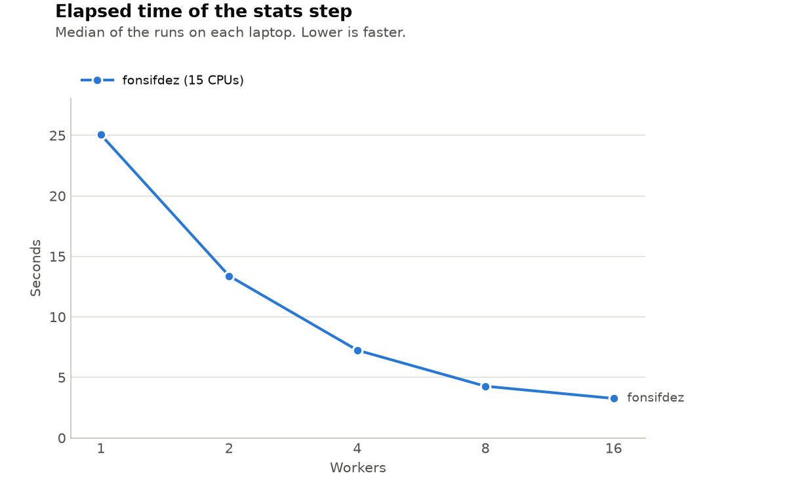

# Lab 1: The Nightly Report

## Warm-up: Generating the report

- **What happened, and why:** The script `run_report.sh` was missing executable permission, preventing it from running directly with `./run_report.sh`.
- **Fix:** The required fix is `chmod +x run_report.sh`. This permission change must be committed and pushed to GitHub so teammates receive it. The final permission change has not yet been verified.

## Task 1: Generating the report again

- **Symptom:** The revenue report was missing because `report.py` exceeded the container's 2 GB memory limit.
- **Commands and diagnosis:** We inspected the script using `cat steps/report.py`, measured performance using `/usr/bin/time -f "$T" python3 steps/report.py`, and checked the output using `python3 tools/check.py`.
- **Cause:** The original code loaded 8.4 million orders into memory, created 12 monthly tables, and combined them. This increased memory consumption beyond the container limit.
- **Fix:** Changed the code to read 100,000 orders at a time using pandas. Revenue is grouped by region and month and accumulated without keeping the entire dataset in memory.
- **Before and after:** The original execution failed. The corrected execution took 3.21 seconds elapsed, 4.22 seconds user CPU, 0.20 seconds system CPU, and 164,400 KB peak memory. The original peak memory measurement was not recorded.
- **Verification:** `revenue_by_region_month.csv` passed `tools/check.py`.

## Task 2: Extracting data

- **Symptom:** All six regional CSV files contained zero rows.
- **Commands and diagnosis:** We inspected the code with `cat steps/extracts.sh`, executed `bash steps/extracts.sh`, and checked the generated files using `python3 tools/check.py`.
- **Cause:** The script used the incorrect relative path `../data/sales_2025.csv`. It also suppressed error messages and did not correctly detect pipeline failures.
- **Fix:** Changed the input path to `${DATA:-$HOME/data/sales_2025.csv}` and added `set -euo pipefail` to improve error detection.
- **Before and after:** Before the fix, all six output files were empty. After the fix, all six regional extracts passed the checker, containing the expected number of rows. Execution-time and memory measurements were not recorded.

## Task 3: Auditing

- **Symptom:** The original script opened and closed the output file for each order, creating excessive file operations.
- **Commands and diagnosis:** We inspected `steps/audit.py`, ran `DATA=~/data/sales_2025_sample.csv /usr/bin/time -f "$T" python3 steps/audit.py`, and verified the outputs using `python3 tools/check.py`.
- **Cause:** Opening and closing a file repeatedly generates unnecessary system calls, increasing overhead. Closing a file also does not guarantee the data has been physically written to disk.
- **Fix:** An optimized version was prepared that keeps the output file open, uses buffered writing, and reads the input in chunks.
- **Before measurements (100,000 orders):**
  - Elapsed time: 0.57 seconds
  - User CPU time: 1.65 seconds
  - System CPU time: 0.14 seconds
  - Peak memory: 129,048 KB
- **Verification:** The full audit was regenerated with 8,400,000 rows and passed the output checker before the optimization. The optimized implementation still requires final verification and before/after system-call measurements.

## Task 4: Segmenting the orders

- **Symptom:** The segmentation process is unnecessarily slow.
- **Commands and diagnosis:** We inspected `steps/segments.py` and verified the output using `python3 tools/check.py`.
- **Cause:** The script processes orders individually using a Python loop and repeatedly calls `datetime.strptime()` to calculate quarters.
- **Potential fix:** Replace per-order Python processing with vectorized pandas operations for calculating quarters, order sizes, and grouped counts.
- **Verification:** The original `segments.csv` passed the checker, but the performance optimization has not been implemented or benchmarked.
- **Before and after:** Performance measurements were not recorded. Further profiling with `cProfile` is required.

## Task 5: Computing the statistics

- **Symptom:** The script defaults to 16 workers regardless of the available CPUs and may leave processes running when interrupted.
- **Commands and diagnosis:** We inspected `steps/stats.sh`, ran `bash tools/sweep.sh fonsifdez`, and verified the output using `python3 tools/check.py`.
- **Cause:** The script uses `WORKERS=${WORKERS:-16}`, a fixed number of workers. It also lacks explicit signal handling and cleanup of background processes.
- **Potential fix:** Select a sensible number of workers based on the available CPU resources and use signal traps to terminate and wait for child processes.
- **Verification:** `stats.csv` passed the checker with 72 region-months. The process-cleanup fix has not yet been implemented or verified.
- **Before and after:** Worker performance was measured, but process-cleanup measurements were not recorded.

## The worker experiment

**Command:** `bash tools/sweep.sh fonsifdez`

The statistics script was tested with 1, 2, 4, 8, and 16 workers, three times for each configuration.

| Workers | Average elapsed time |
|---|---:|
| 1 | 23.93 s |
| 2 | 13.49 s |
| 4 | 7.18 s |
| 8 | 4.30 s |
| 16 | 4.03 s |

**How does elapsed time change with the number of workers?**

Increasing the number of workers generally reduced elapsed time. The improvement was substantial between 1 and 8 workers but much smaller between 8 and 16 workers. At 16 workers, performance was more variable, including one execution that lasted 5.61 seconds.

**Why do the results differ between laptops?**

Differences in CPU cores, threads, system load, and scheduling can affect execution times. Only Alfonso's measurements were available, so an actual comparison with Nico's laptop could not be completed.

**Which default number of workers was chosen, and why?**

The current script still defaults to 16 workers. Based on the recorded measurements, 8 workers appears to offer a reasonable compromise between performance and resource usage on the tested laptop. A final change to the default has not yet been verified.

**Experiment files:**

- `members/fonsifdez/sweep.csv` contains the 15 measurements.
- `results/sweep.png` contains the performance comparison chart.

Nico's individual worker experiment could not be completed before this report was prepared. No results have been invented for his laptop.

## Use of generative AI

**Tool:** ChatGPT, OpenAI.

Generative AI was used to help diagnose errors, suggest code modifications, interpret terminal outputs, and draft explanations for this report.

**Prompts and requests included:**

- Requests to diagnose the empty regional extracts and missing revenue report using terminal outputs.
- Requests to guide the implementation and verification of pipeline fixes.
- Requests to interpret performance measurements and `tools/check.py` results.
- Requests to help prepare and structure the lab report.

AI-assisted code was used for `steps/extracts.sh` and `steps/report.py`, and an optimization was proposed for `steps/audit.py`.

The tested regional extraction and revenue-report fixes passed `tools/check.py`.

